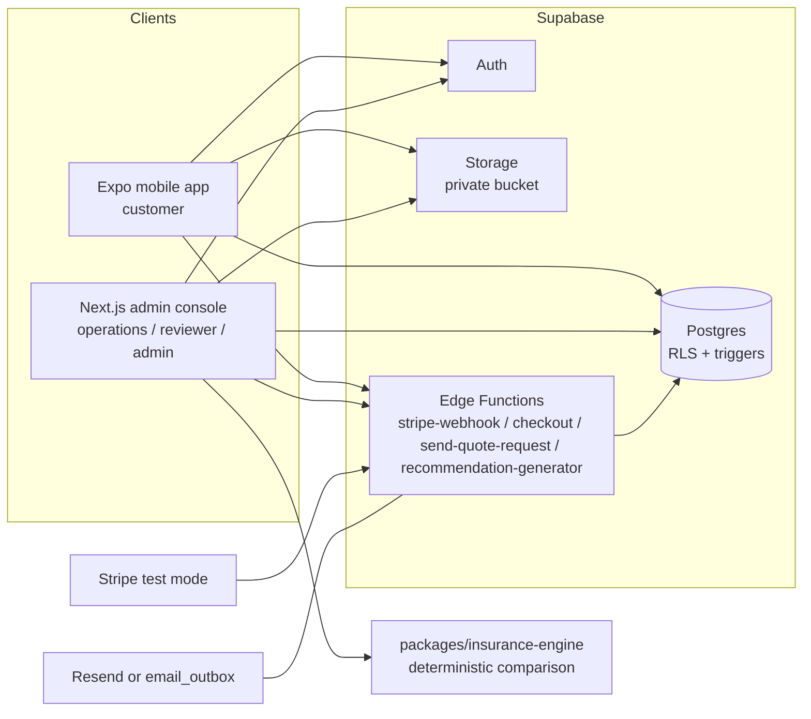
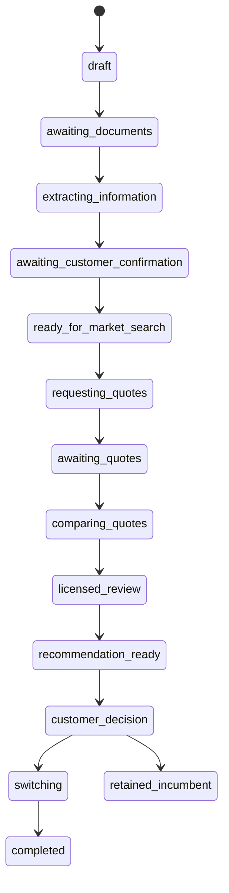

# Architecture

## Overview

Insurance Autopilot is a pnpm/Turborepo monorepo with two applications sharing one Supabase
backend and a set of pure TypeScript packages.

## Key decisions

- **State machines defined once, enforced twice.** Allowed transitions for cases, quote requests,
  quotes and switches live in `packages/schemas/src/state-machines.ts` and are re-implemented as
  Postgres triggers. Clients cannot skip licensed review or cancel an incumbent policy before
  replacement coverage is confirmed, even with direct API access.
- **Deterministic engine.** `packages/insurance-engine` is pure and side-effect free. It builds
  every bundled/split household configuration from usable quotes, always includes the incumbent,
  applies hard mandate constraints, computes total cost in integer cents (premiums + fees +
  cancellation charges − bundle discounts) and ranks with explicit reason codes. No AI decides
  coverage equivalence.
- **Provider adapters.** Email (Resend → `email_outbox` fallback), push (Expo → local log) and
  document extraction (`manual` default, `mock` for demos) are interfaces in
  `packages/database/src/providers`, so the demo runs with zero external services.
- **Money and time.** All money is integer Canadian cents. All timestamps are UTC; UIs render in
  `America/Edmonton`.
- **Audit.** Every state transition and sensitive mutation writes an `audit_events` row; the table
  is append-only via trigger and revoked privileges.

## Case flow

## Workspaces

| Workspace                   | Purpose                                                                                                               |
| --------------------------- | --------------------------------------------------------------------------------------------------------------------- |
| `apps/mobile`               | Customer app: onboarding, 5-tab navigation, documents, questions, recommendation approval with reauthentication       |
| `apps/admin`                | Operations console: dashboard, case queue, case detail (11 tabs), quote entry, comparison, licensed review, switching |
| `packages/schemas`          | Zod schemas, enums, transition maps                                                                                   |
| `packages/insurance-engine` | Comparison and ranking engine + unit tests                                                                            |
| `packages/database`         | Supabase client config and provider adapters                                                                          |
| `packages/test-fixtures`    | Deterministic fixtures including the mandatory bundle-loss scenario                                                   |
