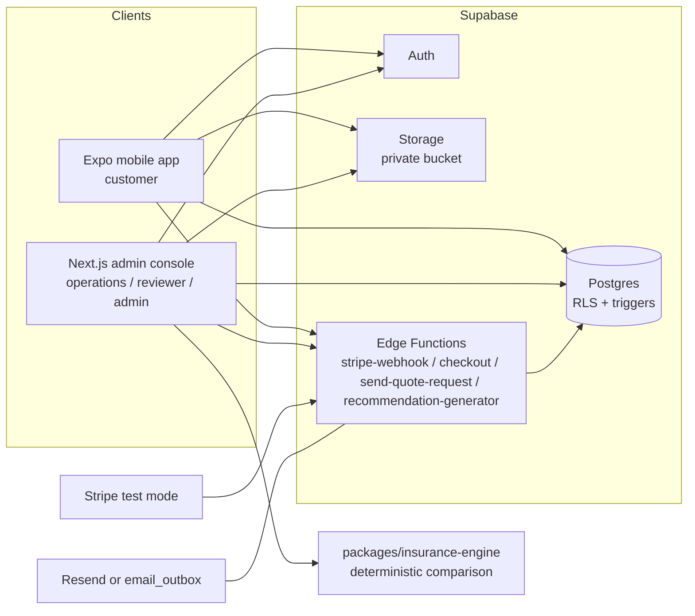

# Architecture

## Overview

Insurance Autopilot is a pnpm/Turborepo monorepo with two applications sharing one Supabase
backend and a set of pure TypeScript packages.

## Key decisions

- **State machines defined once, enforced twice.** Allowed transitions for cases, quote requests,
  quotes and switches live in `packages/schemas/src/state-machines.ts` and are re-implemented as
  `security definer` Postgres triggers. Clients cannot skip licensed review or cancel an incumbent
  policy before replacement coverage is confirmed, even with direct API access.
- **Workflow authorization is RPC-based.** Customer and staff workflow mutations (recommendation
  approve/decline, licensed review, switch advancement, support questions) are exposed only as
  `security definer` functions. Direct `update`/`insert` on workflow tables is denied to
  `authenticated` by RLS; the RPCs verify household membership, role and state before changing data.
- **V2 coverage mandate is the active source of truth.** `packages/schemas/src/mandate-v2.ts`
  defines the canonical `HouseholdCoverageMandateV2` schema with discriminated monetary rules and
  explicit versioned jurisdiction. Adapters in `packages/schemas/src/mandate-adapters.ts` convert
  V2 to the legacy engine `HouseholdMandate` and back. `packages/database/src/recommendation-loader.ts`
  is the single trusted server-side loader used by the recommendation Edge Function and workspace
  tests; it validates every row as V2 before the engine runs and never falls back to legacy values.
- **Public mandate validation, internal persistence.** Mobile saves mandates through the authenticated
  `save-household-mandate` Edge Function, which validates the full V2 schema and every asset association
  before invoking the service-role-only `persist_household_mandate_v2` RPC. The recommendation
  `recommendation-generator` Edge Function similarly validates the input snapshot, runs the engine, and
  calls the internal `persist_engine_recommendation_v2` RPC with the authenticated actor profile ID.
  Both raw RPCs are revoked from authenticated users.
- **One engine, two runtimes.** `packages/insurance-engine/src/engine.ts` is the only engine source.
  `pnpm --filter @autopilot/insurance-engine build:edge` bundles it into
  `supabase/functions/recommendation-generator/_shared/autopilot.js` for the Supabase Edge Function;
  the bundle header contains a SHA-256 source hash and CI enforces parity with `check:edge`.
- **Deterministic engine.** `packages/insurance-engine` is pure and side-effect free. It builds
  every bundled/split household configuration from usable quotes, always includes the incumbent,
  applies hard mandate constraints through a reusable monetary-rule evaluator, handles asset-specific
  mandate inheritance (vehicle/property overrides), detects coverage reductions vs the incumbent,
  computes total cost in integer cents (premiums + fees + cancellation charges − bundle discounts)
  and ranks deterministically with explicit reason codes. The canonical ranking order is hard
  eligibility, total cost, missed preferred requirements, unknown preferred requirements, deductible
  exposure, underwriting conditions, and a stable identifier. The engine is currently fail-closed on
  multi-asset optimization (more than one vehicle or more than one property). No AI decides coverage
  equivalence. Legacy `coverage_requirements` rows remain only for historical migration, diagnostics
  and rollback analysis; no active recommendation or approval path reads them.
- **Quote validation boundary.** Only `quote_coverages` rows with `validation_status = 'valid'` are
  passed to the engine. `validation_status`, `validation_errors`, `validated_at`, `validated_by`,
  `coverage_schema_version` and `data_source` track data quality. The `quote_coverages_coverage_changed`
  trigger resets validation to `draft` when coverage changes, requiring re-validation before
  evaluation.
- **Provider adapters.** Email (Resend → `email_outbox` fallback), push (Expo → local log) and
  document extraction (`manual` default, `mock` for demos) are interfaces in
  `packages/database/src/providers`, so the demo runs with zero external services.
- **Money and time.** All money is integer Canadian cents. All timestamps are UTC; UIs render in
  `America/Edmonton`.
- **Audit.** Every state transition and sensitive mutation writes an `audit_events` row; the table
  is append-only via trigger and revoked privileges. Audit rows are never created by client code.
- **Type safety from generated schema.** `packages/database/src/database.types.ts` is generated
  with `pnpm db:types` from the local Supabase schema and consumed by `createClient<Database>` in
  both apps; `db:types:check` runs in CI to prevent drift.
- **Payments idempotency.** The Stripe webhook endpoint verifies signatures and delegates
  processing to the `process_stripe_event` RPC, which records every event, handles retries and
  never double-applies a subscription update.

## Case flow

```mermaid
stateDiagram-v2
  [*] --> draft
  draft --> awaiting_documents
  awaiting_documents --> extracting_information
  extracting_information --> awaiting_customer_confirmation
  awaiting_customer_confirmation --> ready_for_market_search
  ready_for_market_search --> requesting_quotes
  requesting_quotes --> awaiting_quotes
  awaiting_quotes --> comparing_quotes
  comparing_quotes --> licensed_review
  licensed_review --> recommendation_ready
  recommendation_ready --> customer_decision
  customer_decision --> switching
  customer_decision --> retained_incumbent
  customer_decision --> licensed_review : mandate changed; regenerate
  switching --> completed
```

## Workspaces

| Workspace                   | Purpose                                                                                                               |
| --------------------------- | --------------------------------------------------------------------------------------------------------------------- |
| `apps/mobile`               | Customer app: onboarding, 5-tab navigation, documents, questions, recommendation approval with reauthentication       |
| `apps/admin`                | Operations console: dashboard, case queue, case detail (11 tabs), quote entry, comparison, licensed review, switching |
| `packages/schemas`          | Zod schemas, enums, mandate schemas, transition maps                                                                  |
| `packages/insurance-engine` | Comparison and ranking engine + Edge Function bundle generation + unit tests                                          |
| `packages/database`         | Supabase typed client (`Database`), generated types and provider adapters                                             |
| `packages/test-fixtures`    | Deterministic fixtures including the mandatory bundle-loss scenario                                                   |
