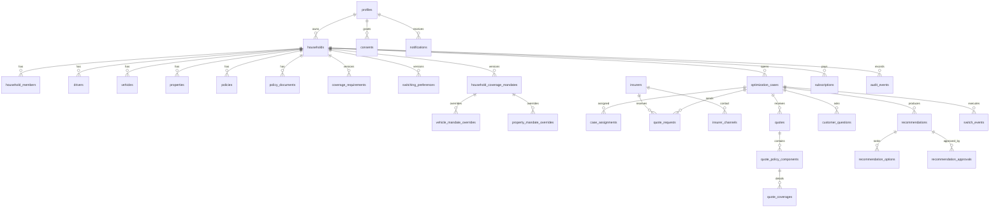

# Data model

All tables use UUID primary keys, `created_at`/`updated_at` (UTC, trigger-maintained), and integer
Canadian cents for money. Statuses are explicit Postgres enums; soft deletion is not used — audit
history lives in `audit_events`.

## Table groups

- **Identity & household**: `profiles` (role: customer/operations/reviewer/admin), `households`,
  `household_members`, `drivers`, `vehicles`, `properties`.
- **Policies & documents**: `policies` (current and historical), `policy_documents` (category,
  status, private storage path).
- **Mandate**: `household_coverage_mandates` is the authoritative versioned mandate table
  (`schema_version`, `version`, `jurisdiction`, `effective_from`, `household_auto_defaults`,
  `household_property_defaults`, `is_current`). Asset-specific overrides live in
  `vehicle_mandate_overrides` and `property_mandate_overrides`, guarded by a trigger that rejects
  cross-household assets. `switching_preferences` remains versioned and stores economic/process
  rules; `customer_approval_required` is constrained true and `material_coverage_reductions_allowed`
  is constrained false. The legacy `coverage_requirements` table is still readable for backward
  compatibility but new writes go through `save_household_mandate_v2`.
- **Market**: `insurers` (8 fictional carriers), `insurer_channels`.
- **Workflow**: `optimization_cases`, `case_assignments`, `quote_requests`, `quotes`,
  `quote_policy_components`, `quote_coverages`, `customer_questions`.
- **Decision**: `recommendations` (versions, quote ids, mandate version, reason codes,
  comparison JSON), `recommendation_options`, `recommendation_approvals` (role, metadata incl.
  disclosure version). `comparison.materialDifferences` records human-readable coverage reductions.
- **Execution**: `switch_events` with `replacement_confirmed_at` / `incumbent_cancelled_at`;
  a trigger blocks cancellation states before replacement confirmation.
- **Billing & comms**: `subscriptions` (one per profile), `consents`, `notifications`,
  `email_outbox`, `quote_request_sends` (DB-backed send audit/rate limit), `stripe_webhook_events`
  (idempotency: `status`, `attempt_count`, `last_error`, `completed_at`).
- **Audit**: `audit_events` — append-only (trigger + revoked update/delete).

## State machines

Enforced by `security definer` triggers `validate_case_transition`,
`validate_quote_request_transition`, `validate_quote_transition`, `validate_switch_transition`;
the same maps are exported from `@autopilot/schemas` for clients and tests. Workflow mutations are
performed by `security definer` RPCs that validate the transition before applying it. See
`docs/architecture.md` for the case diagram.
