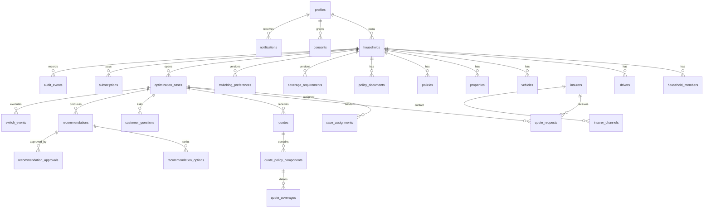

# Data model

All tables use UUID primary keys, `created_at`/`updated_at` (UTC, trigger-maintained), and integer
Canadian cents for money. Statuses are explicit Postgres enums; soft deletion is not used — audit
history lives in `audit_events`.

## Table groups

- **Identity & household**: `profiles` (role: customer/operations/reviewer/admin), `households`,
  `household_members`, `drivers`, `vehicles`, `properties`.
- **Policies & documents**: `policies` (current and historical), `policy_documents` (category,
  status, private storage path).
- **Mandate**: `coverage_requirements` and `switching_preferences`, versioned with `is_current`.
  `customer_approval_required` is constrained true.
- **Market**: `insurers` (8 fictional carriers), `insurer_channels`.
- **Workflow**: `optimization_cases`, `case_assignments`, `quote_requests`, `quotes`,
  `quote_policy_components`, `quote_coverages`, `customer_questions`.
- **Decision**: `recommendations` (versions, quote ids, mandate version, reason codes,
  comparison JSON), `recommendation_options`, `recommendation_approvals` (role, metadata incl.
  disclosure version).
- **Execution**: `switch_events` with `replacement_confirmed_at` / `incumbent_cancelled_at`;
  a trigger blocks cancellation states before replacement confirmation.
- **Billing & comms**: `subscriptions`, `consents`, `notifications`, `email_outbox`,
  `stripe_webhook_events` (idempotency).
- **Audit**: `audit_events` — append-only (trigger + revoked update/delete).

## State machines

Enforced by triggers `validate_case_transition`, `validate_quote_request_transition`,
`validate_quote_transition`, `validate_switch_transition`; the same maps are exported from
`@autopilot/schemas` for clients and tests. See `docs/architecture.md` for the case diagram.
